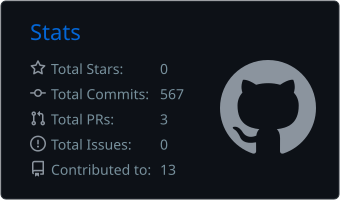
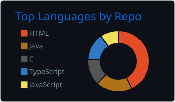

<h2 align="center">Hi 👋! My name is Thiago and I'm a Developer, from Brazil!</h2> 
   
   
          
   
      
   <picture> <source media="(prefers-color-scheme: dark)" srcset="https://raw.githubusercontent.com/Thg1zZ/Thg1zZ/output/pacman-contribution-graph-dark.svg"> <source media="(prefers-color-scheme: light)" srcset="https://raw.githubusercontent.com/Thg1zZ/Thg1zZ/output/pacman-contribution-graph.svg">  </picture>
